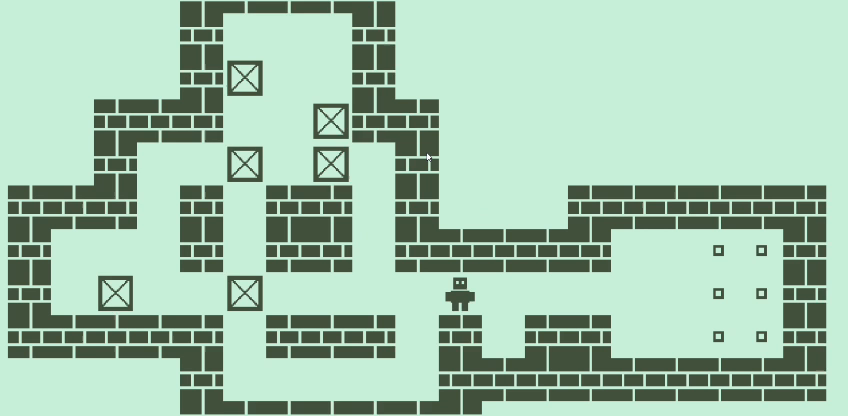

# Sokoban · OpenGL Puzzle Game

A retro warehouse puzzle in C++ with SDL2 and OpenGL 3.3. Push every crate onto a goal to solve each of the three levels. The title bar tracks the current level and move count.



## Controls

| Key | Action |
| --- | --- |
| Arrow keys or WASD | Move or push a crate |
| U | Undo a move |
| R | Restart the current level |
| N | Skip to the next level |
| Esc | Quit |

## Build on Windows

Use a 64-bit MinGW compiler, CMake 3.20 or newer, the [SDL2 MinGW development package](https://github.com/libsdl-org/SDL/releases/tag/release-2.32.10), and a graphics driver that supports OpenGL 3.3. Make sure `g++`, `mingw32-make`, and `cmake` are on `PATH`.

In PowerShell, set `$sdl` to the `x86_64-w64-mingw32` folder inside the extracted SDL2 development package.

```powershell
$sdl = 'C:\path\to\SDL2\x86_64-w64-mingw32'
cmake -S . -B build -G 'MinGW Makefiles' "-DCMAKE_PREFIX_PATH=$sdl"
cmake --build build
.\build\sokoban.exe
```

## Implementation

The game parses ASCII level maps into a grid and keeps goal tiles separate from movable crates. It saves the previous grid before each successful move so undo can restore both the player and crate positions. An OpenGL shader draws the tiles in a two-tone handheld-console style.
